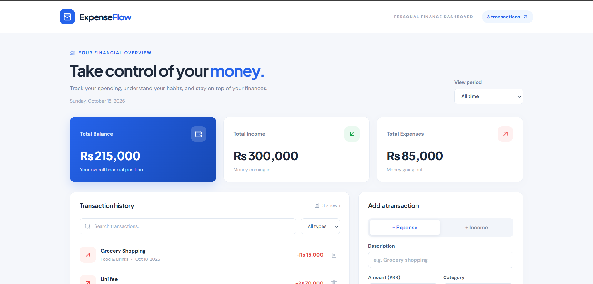
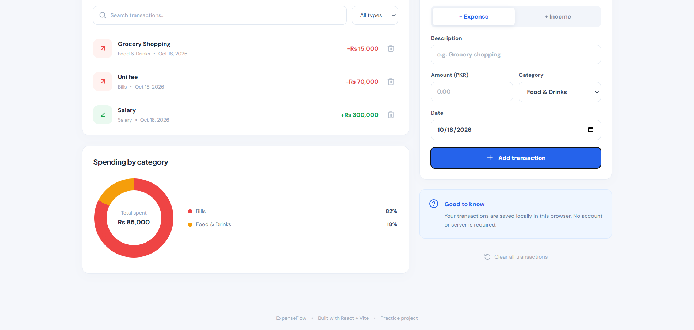

# ExpenseFlow — React Expense Tracker

A responsive, frontend-only personal finance dashboard built with React 19 and Vite. This practice project demonstrates all eight core React concepts in the assignment.

## Getting started

Requires Node.js 20.19+ or 22.12+ and npm.

```bash
npm install
npm run dev
```

Open the local URL displayed by Vite. For a production build, run `npm run build`.

## Features

- Add income and expense transactions using a validated, controlled form.
- View balance, income and expense totals; select a month.
- Search and filter transaction history; delete transactions.
- View spending by category in a CSS donut chart.
- Save transactions in browser localStorage; sample data appears on first launch.
- Responsive layout for desktop and mobile.

## Assignment concept mapping

| Requirement | Implementation |
|---|---|
| 1. Components and JSX | `Navbar`, `Card`, `SummaryCard`, `TransactionForm`, etc. |
| 2. State and events | `useState` in `App` and `TransactionForm`; button handlers |
| 3. Props, defaults, children | `Card.jsx`, `SummaryCard.jsx`, `Navbar.jsx` |
| 4. Lists and conditions | `.map()` with stable IDs, filters, empty states |
| 5. Effects and cleanup | `useLocalStorage.js` persistence; `LiveClock.jsx` interval cleanup |
| 6. Custom hooks | `useLocalStorage.js` and `useTransactions.js` |
| 7. Controlled forms | `TransactionForm.jsx` input state and validation |
| 8. Mini-project | All functionality integrated in `App.jsx` |

**About `defaultProps`:** React function components now commonly use JavaScript default parameters (`kind = 'balance'`, `action = null`) instead of the older `Component.defaultProps` property. This demonstrates the same default behavior.

## File structure

```text
src/
  components/     # reusable UI
  hooks/          # reusable stateful logic
  data/           # categories and colors
  App.jsx         # dashboard composition
  App.css         # component styles
  index.css       # global styles
  main.jsx        # entry point
```

## Screenshots



## Notes

- No backend, database or authentication is included; data is stored in the current browser.
- Currency is displayed in PKR, and the app starts with editable demo transactions.
- This project is for learning and is not financial software.
